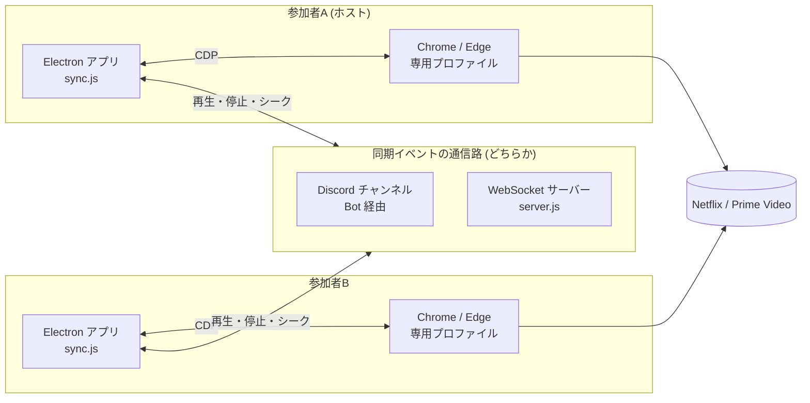
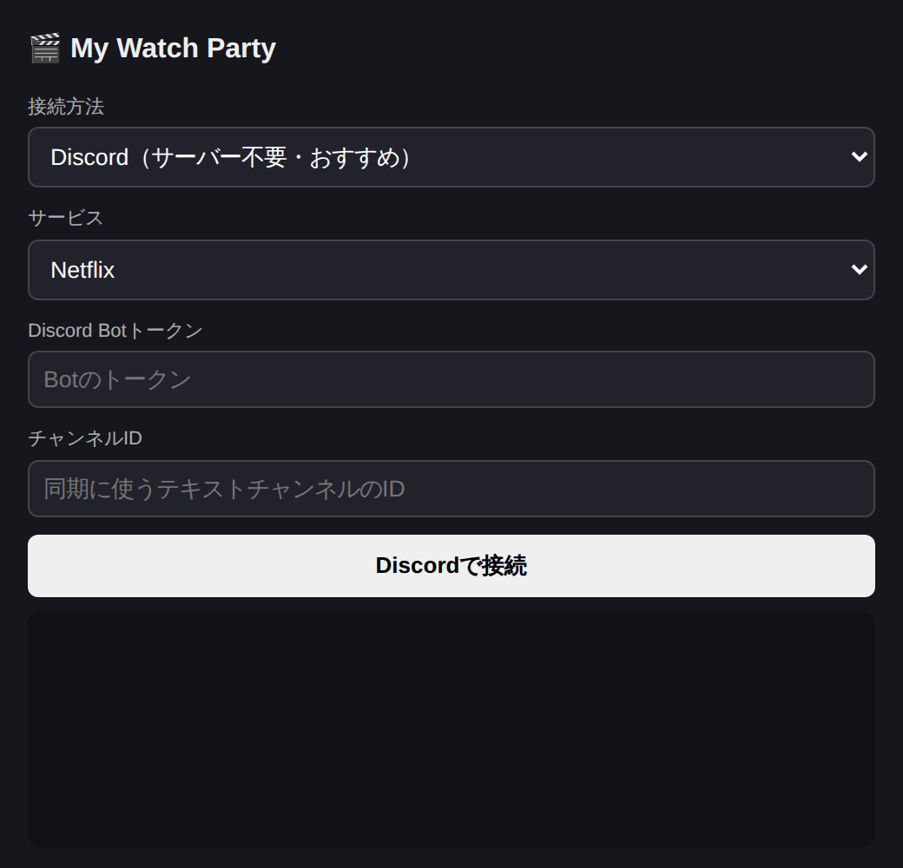

# My Watch Party — 再生同期デスクトップアプリ

[](https://github.com/ten-ten66/watch-party/actions/workflows/ci.yml)

> 本プロジェクトは **Claude Code を用いたAI駆動開発** で設計・実装しました。

Netflix / Amazon プライムビデオの再生位置を、離れた場所にいる友達と同期するデスクトップアプリです。
各PCにインストールする **Electron アプリ** と、操作イベントだけを中継する **同期の通信路**（Discord または自前の WebSocket サーバー）で構成しています。チャット機能はなく、再生の同期だけを行います。

## 構成図





## 技術スタック

| 分類 | 使用技術 |
|---|---|
| デスクトップ | Electron 31, electron-builder（Windows: NSIS / macOS: dmg / Linux: AppImage） |
| ブラウザ制御 | Chrome DevTools Protocol（自前クライアント `cdp.js`） |
| 通信 | WebSocket（ws）, discord.js 14 |
| サーバー | Node.js（ルーム管理とイベント中継のみの軽量リレー） |
| 言語 | JavaScript |

## 主な機能

- Netflix / プライムビデオの **再生・一時停止・シークを全員に同期**
- 後から参加した人を **ホストの再生位置に自動で合わせる**
- 通信路を **Discord（サーバー不要）** と **自前サーバー（6桁のルームID）** から選べる
- インストール済みの Chrome / Edge を自動検出し、専用プロファイルで起動

## 工夫した点

- **DRM を回避せずに同期する設計**：DRM で保護された動画はアプリに埋め込めないため、本物の Chrome をデバッグポート付きで起動し、DevTools Protocol で `<video>` の状態を 0.5 秒ごとに監視する方式にした。動画データは送らず、各自が自分の契約で再生するので、画質も DRM もそのまま
- **エコー（操作のループ）防止**：相手の操作を反映した直後の 1.5 秒間は、自分の操作として検知しないように抑制
- **サーバー不要の Discord モード**：Discord のテキストチャンネルを中継役に使い、ホスティングなしで遠隔同期できる。自分の送信は自動で見分ける
- **テストしやすい同期エンジン**：`sync.js` を Electron 非依存に保ち、偽のページ・偽の通信路を差し込んで `node --test` で検証（停止・シークの検知、エコー防止、途中参加時の同期）
- **通信路の抽象化**：`transports.js` で WebSocket と Discord を同じインターフェースにまとめ、同期エンジンを通信手段から切り離した

## セットアップ

### A. Discordモード（サーバーのホスティング不要）

Discordのテキストチャンネルを中継役に使う。動画やチャットは流れず、`[MWP]{...}` という同期メッセージが再生操作のたびに投稿されるだけ（専用チャンネルを作るのがおすすめ）。

1. [Discord Developer Portal](https://discord.com/developers/applications) で「New Application」→ 名前をつけて作成
2. 左メニュー「Bot」→ **「MESSAGE CONTENT INTENT」をON**（重要）→ 「Reset Token」でトークンをコピー
3. 左メニュー「OAuth2 → URL Generator」→ Scopes: `bot`、Permissions: `View Channels` `Send Messages` `Read Message History` → 生成されたURLを開いて友達との共有サーバーにBotを招待
4. Discordの設定 → 詳細設定 → 「開発者モード」ON → 同期用チャンネルを右クリック → 「チャンネルIDをコピー」
5. アプリで接続方法「Discord」を選び、Botトークンとチャンネル IDを入力して「Discordで接続」

トークンとチャンネルIDを友達にも共有すれば、全員が同じBotで接続できる（アプリが自動で自分の送信を区別する）。心配なら各自がBotを作って同じチャンネルに招待してもよい。

### B. 自前サーバーモード

```bash
cd server
npm install
npm start   # ws://0.0.0.0:8787
```

遠隔の友達と使うにはインターネットから見える場所に置く：
- VPS / Render / Railway / fly.io（無料枠で十分。TLS終端がある場合はURLを `wss://` に）
- または自宅PCで `cloudflared tunnel` / `ngrok` で一時公開

### アプリ本体（参加者全員）

開発実行:
```bash
cd app
npm install
npm start
```

インストーラー作成（配布用）:
```bash
npm run dist   # Windows: NSIS / macOS: dmg / Linux: AppImage が dist/ にできる
```
※ Windows用インストーラーはWindows上で、macOS用はmac上でビルドするのが基本。

### 使う

1. アプリを起動し、接続方法とサービス（Netflix/プライムビデオ）を選ぶ
2. 接続すると専用プロファイルのChromeが自動で開くので、**初回のみログイン**して作品の再生ページを開く
3. Discordモード: 全員が同じチャンネルに接続すれば完了 / サーバーモード: ホストの6桁ルームIDを相手が入力して参加
4. 参加した側は自動でホストの再生位置に同期。以降、誰が再生・停止・シークしても全員に反映される
5. Discordの通話（VC）を併用すれば、話しながら観られる

## テスト

```bash
cd app
npm install
npm test   # 同期エンジンの単体テスト（node:test）
```

## 制限・注意

- **参加者全員に各サービスの契約が必要**
- 対応OS: Windows / macOS / Linux（Chrome または Edge のインストールが必要）
- Netflixのシーク制御は非公開の内部APIに依存。Netflix側の更新で壊れたら `sync.js` の `controlScript()` を修正
- アプリが起動する専用プロファイルは通常のブラウザと別物なので、初回はログインし直しが必要（2回目以降は記憶される）
- 通話機能はないので、LINE通話やDiscordを併用推奨
